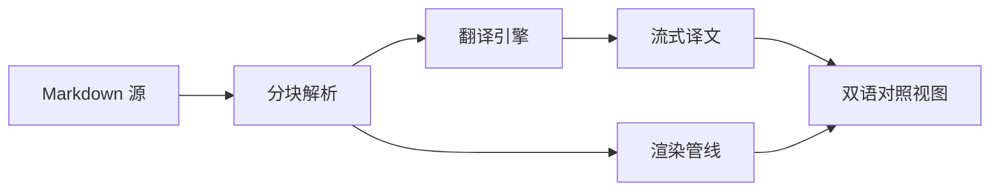
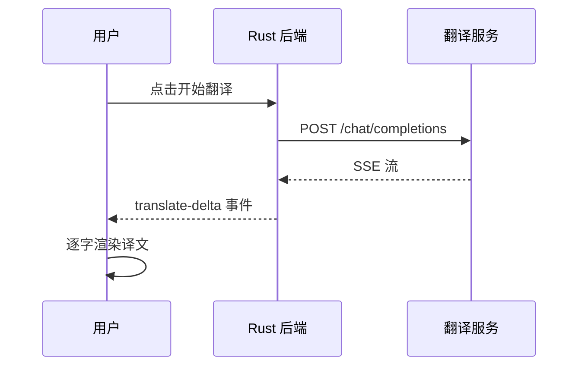

# MarkThink 渲染能力测试

这是一份用来验证 Markdown 渲染器各项能力的测试文档，覆盖排版、代码、公式、图表与结构化内容。

## 1. 基础排版

普通段落包含**粗体**、*斜体*、~~删除线~~、`行内代码`、以及[外部链接](https://example.com)。

行内公式示例：质能方程 $E = mc^2$，以及欧拉恒等式 $e^{i\pi} + 1 = 0$。

> **引用块**
>
> 良好的排版是阅读体验的基础。中文排版需要注意标点、字距与行高。

## 2. 列表

- 无序列表项一
- 无序列表项二
  - 嵌套子项 A
  - 嵌套子项 B
- 无序列表项三

1. 有序列表第一步
2. 有序列表第二步
3. 有序列表第三步

- [x] 已完成任务
- [ ] 待办任务
- [ ] 另一个待办

## 3. 代码

TypeScript：

```typescript
interface ReadingOptions {
  fontSize: number;
  lineHeight: number;
  contentWidth: number;
}

function applyTypography(el: HTMLElement, opts: ReadingOptions): void {
  el.style.setProperty("--reading-font-size", `${opts.fontSize}px`);
  el.style.setProperty("--reading-line-height", String(opts.lineHeight));
  el.style.setProperty("--content-width", `${opts.contentWidth}px`);
}
```

Rust：

```rust
#[derive(Debug, Clone, Serialize)]
struct Block {
    id: String,
    text: String,
}

impl Block {
    fn new(id: impl Into<String>, text: impl Into<String>) -> Self {
        Self { id: id.into(), text: text.into() }
    }
}
```

Python：

```python
def chunk_blocks(blocks, max_blocks=12, target_height=900):
    """Group consecutive blocks into virtualised chunks."""
    chunks, start, height = [], 0, 0
    for i, block in enumerate(blocks):
        height += len(block["source"].splitlines()) * 14
        if height >= target_height or i - start + 1 >= max_blocks:
            chunks.append((start, i + 1))
            start, height = i + 1, 0
    return chunks
```

Bash：

```bash
npm install
npm run tauri:build
```

## 4. 数学公式

块级公式：

$$
\int_{-\infty}^{\infty} e^{-x^2} \, dx = \sqrt{\pi}
$$

矩阵：

$$
\begin{pmatrix}
a & b \\
c & d
\end{pmatrix}
\begin{pmatrix}
x \\
y
\end{pmatrix}
=
\begin{pmatrix}
ax + by \\
cx + dy
\end{pmatrix}
$$

## 5. 表格

| 引擎 | 流式 | 需要密钥 | 适用场景 |
| --- | --- | --- | --- |
| OpenAI 兼容 | ✅ | ✅ | 高质量技术文档 |
| Ollama | ✅ | ❌ | 离线与隐私场景 |
| DeepL | ❌ | ✅ | 通用翻译质量最优 |
| Google | ❌ | ❌ | 长文快速初译 |
| LibreTranslate | ❌ | ❌ | 私有化部署 |

## 6. 图表





## 7. 分隔线与脚注

---

这里有一个脚注引用[^1]，还有第二个[^2]。

[^1]: 脚注一：渲染管线按块级 AST 分段，保证代码与公式不被翻译破坏。
[^2]: 脚注二：大文档采用分块窗口化渲染，只挂载视口附近的 DOM。

## 8. 嵌套结构

1. 第一层
   > 引用嵌套在列表中
   
   内容继续：

   ```js
   console.log("列表内的代码块");
   ```

2. 第二层
   - 更深一层
   - 并列项

## 9. 长段落测试

Markdown 的核心价值在于把写作与排版分离。作者只需要关注内容结构——标题层级、段落划分、列表组织、代码归属——而把字体、行高、间距、颜色、对齐等视觉决策交给渲染器。这种分离让同一份源文件可以适应屏幕阅读、打印输出、幻灯片演示等不同场景，也让文档能够被版本控制系统追踪、被自动化工具处理。

在中文技术文档中，这一点尤其重要。中英文混排需要处理字距、标点宽度、换行规则；代码片段需要保持等宽对齐；数学公式需要独立于正文的排版逻辑。一个优秀的阅读器应当把这些细节全部处理好，让读者注意不到排版本身，只注意到内容。
